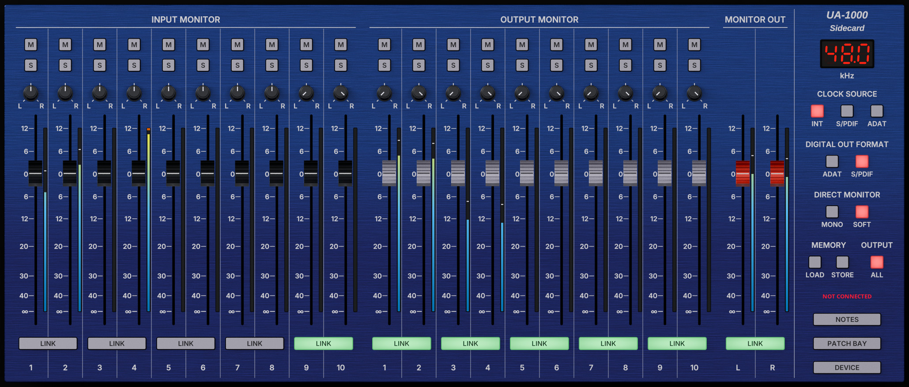
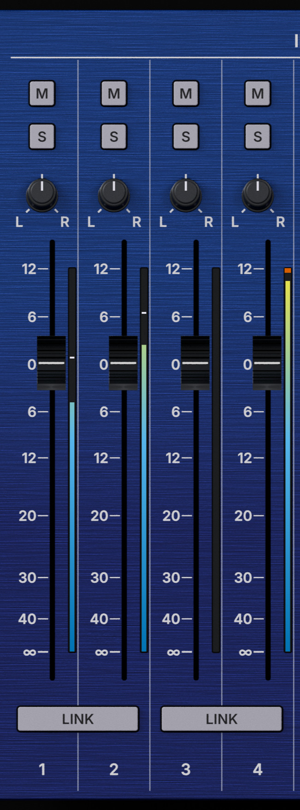
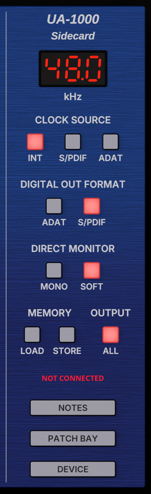

# UA-1000 Sidecard

<p align="center"></p>

UA-1000 Sidecard is the **control panel** that the Roland/EDIROL UA-1000 audio interface never had on Linux: a
desk with its two ten-channel monitor mixers, its patch bay, its front-panel switches, its five memories and its
power-on settings, in the device's own colours. It comes as a panel, `ua1000gui`, and a command-line tool,
`ua1000ctl`, and both speak to the device exactly the way the vendor's own control panel does — byte for byte,
checked against USB captures of it.

This is an independent project and is **not affiliated with, endorsed by, or connected to Roland Corporation**.
"Roland", "EDIROL" and "UA-1000" only name the hardware it works with.

---

> **Full disclosure: This project was vibe-coded.**
>
> UA-1000 Sidecard was developed by a musician/audio engineer ([NiLace](https://github.com/NiLace)) directing [Claude](https://claude.ai) (Anthropic's AI) through natural language conversation. The author described what the project should do and how it should behave, and captured the vendor's USB traffic it is built on. Claude wrote the C code, the build system, and this README.
>
> The author is not a professional programmer, though he can read C. Every line of code in this project was generated by AI. What the code does was checked by tests, and what only the hardware can show on the author's own UA-1000.
>
> If AI-generated code is a concern for you, this is your notice. You should know how it was made.

---

## What it does

The UA-1000 has always worked on Linux as a sound card: plug it in and its ten channels play and record. But half
of what makes it useful lives in software. Inside it there are two digital monitor mixers — one for what comes in
through its inputs, one for what the computer plays — and a patch bay that decides what the computer records and
what each output plays. The front panel has a couple of volume knobs, but no faders, pans or routing for any of
that. On Windows, the vendor's control panel does the job. On Linux there was nothing, so the mixers stayed
wherever they had been left.

UA-1000 Sidecard brings them back: every fader, pan, mute, solo and link of both mixers, MONITOR OUT, the patch
bay and its presets, the front-panel switches, the five memories and the USER SET the device powers up with. It
remembers what you set, and puts the device back the way you left it every time it connects.

There was a second wall, in the kernel. Its driver for the UA-1000 never exposed the USB-MIDI cable the device is
controlled through, so nothing sent from Linux could reach the mixers. A small patch to the driver opens it — see
[The kernel patch](#the-kernel-patch).

## The panel

The desk has the device's three sections side by side, and a master section on the right:

| | |
|---|---|
|  |  |
| A channel: mute, solo, pan, fader and meter | The master section |

- **INPUT MONITOR** — the direct monitor: your inputs as you hear them while you play, with no trip through the
  computer. Ten strips, linkable in pairs.
- **OUTPUT MONITOR** — what the computer plays to each of its ten outputs, mixed for your phones and monitors.
- **MONITOR OUT** — the level of the whole mix, left and right, on its way to the phones and the main outputs.
- **The sample-rate display** — the rate the device runs at. Click it to choose the rate it starts at next time.
- **CLOCK SOURCE** and **DIGITAL OUT FORMAT** — where the device takes its clock from, and what its digital output
  speaks. With nothing plugged into S/PDIF or ADAT, keep the clock on INT.
- **DIRECT MONITOR: MONO, SOFT** and **OUTPUT: ALL** — the front panel's switches, in the device's own sections.
  Press one on the device and the panel follows.
- **MEMORY** — LOAD and STORE for the device's five memories.
- **NOTES** — a notepad for what is wired where, so you never have to unrack the thing to find out.
- **PATCH BAY** — what the computer records, and what each output plays.
- **DEVICE** — the menu with everything else: send all settings, reconnect, the USER SET, reset to defaults.

Each fader has a meter beside it that reads the audio itself. The channel meters show the signal arriving at each
strip; MONITOR OUT's show the mix after every fader, mute and solo, as the device sends it back. The one thing no
meter can see is the device's own OUTPUT volume knob — it sends nothing.

A double click returns a fader to 0 dB and a pan to the centre. The window resizes to anything you like and the
desk keeps its proportions.

**Every part of the panel, with pictures, is explained in the [user's guide](docs/GUIDE.md)** — including how to
read the meters.

`ua1000ctl` does all of it from a terminal or a script:

```sh
ua1000ctl input 1 gain -6          # INPUT MONITOR channel 1 to -6 dB
ua1000ctl output 3-4 link on       # link OUTPUT MONITOR channels 3 and 4
ua1000ctl preset output hard-thru  # a patch-bay preset
ua1000ctl status                   # what the editor knows, without the device
```

## Restoring the device's factory settings

This is done on the device, not from the computer (Owner's Manual, p. 44):

1. Hold down the OUTPUT VOLUME select switch and the STEREO/MONO switch while you turn the power on. Both blink.
2. Press STEREO/MONO once more. They blink faster, SOFT CTRL lights, and both go out: the factory settings are
   back (STEREO, SOFT CTRL on, ADAT off, EXT CLOCK off, output volume on MAIN). Pressing any other lit switch at step 2
   cancels it.

The panel's DEVICE > Reset to Defaults puts its switches in the same factory state.

## The kernel patch

The UA-1000 talks over two USB-MIDI cables: one for its MIDI jacks, one for its control. The kernel's
`snd-ua101` driver only declares the first, so the control cable — the one the mixers listen on — is simply not
there. The patch declares both again, as the kernel did before the UA-1000 moved to that driver. Your MIDI jacks
keep their port; the control port appears beside it as `UA-1000 Control`; audio is not touched.

To see whether you need it, run `amidi -l` with the device on. If `UA-1000 Control` is listed, you don't.

Until the change is part of the kernel itself, the patched module is built for your kernel and loaded by hand, or
installed so it loads at every boot. **[docs/KERNEL_PATCH.md](docs/KERNEL_PATCH.md)** walks through all of it:
build, load, install, remove, what to do after a kernel update, and what has been tested.

## Tested on the device

With the patched driver on Linux 7.0:

- the driver shows both ports, and the tools find the control port by name;
- every switch pressed on the front panel (MONO, SOFT CTRL, ALL) shows up on screen;
- on connecting, the panel reads the device's own settings and shows them, and the device is left as it is (it
  reports what is pressed on its front panel; at power-on it loads its USER SET, mixer included);
- the mixer answers: faders, mute, pan, an input heard through the direct monitor; and the fader law holds in the
  device's own audio — a fader at −11.874 dB took a playback peaking at 1.000 to 0.25464, 0.007 dB from the law;
- linked pairs: gain, mute and solo follow, and the pan mirrors;
- SOLO, value by value: the device holds one solo per pair (soloing both channels of an unlinked pair silenced
  everything; found and fixed);
- the meters read the device's audio (22 sources through PipeWire); MONITOR OUT's follow the faders, mute and pan
  but not the OUTPUT knob; and they come back by themselves after the device is switched off and on (found and
  fixed);
- the patch bay's WAVE IN side: the Loop Back preset, MONITOR OUT recorded as the mix itself, Initial Setting;
- the memories: store, load (the faders come back), a part of them alone, and the notice for one this editor did
  not store;
- the USER SET at every rate the device has, 44.1, 48, 88.2 and 96 kHz, with ADAT off at the two high ones and a
  USER SET that would keep it on refused; MONO switched at 96 kHz with no dropout;
- Reset to Defaults, and an input's meter with a guitar on it;
- switching the device off: the panel says so without freezing, and DEVICE > Reconnect brings it back;
- a second program is turned away at once while the panel holds the port (this check found a hang, now fixed);
- the patch bay's OUTPUT side, by ear on monitors on outputs 1-2: WAVE OUT 3-4 there silences them, MONITOR OUT
  plays the computer and a guitar on input 2 together, Hard Thru plays the guitar alone on the right, Initial
  Setting the computer alone.

Still untested on the hardware: what the device makes of the bracket the panel sends around a drag.

## What it doesn't do (yet)

Stated here so it doesn't have to be inferred:

- **One solo per pair.** The device holds a single solo for each pair of channels, so in an unlinked pair only one of
  the two can be soloed: soloing one takes it from the other. A linked pair solos together.
- **Pan on a linked pair** mirrors the partner (hard left on one, hard right on the other). The vendor's own
  behaviour for it was never captured, so this is a choice, not a copy.
- **No 192 kHz.** The Owner's Manual (p. 38) says the device plays back at 192 kHz (outputs 1/2 and the phones only,
  no recording) with its factory USER SET, after a factory reset, the switch on USER SET. The editor's USER SET offers
  44.1 to 96 kHz, and storing one replaces that factory USER SET. 192 kHz has not been tried here: neither its code nor
  whether the Linux driver plays it is known.
- **The external clock's lock is not shown.** The device blinks its EXT CLK light while it is not synchronised;
  whether it reports that over USB is unknown.
- **With no signal on S/PDIF or ADAT, the clock must stay on INT.** On an external source with nothing arriving the
  device has no clock and the audio stops; back on INT it plays again. The panel warns you when you pick one. Once,
  early on, the panel froze after a run of clock changes; the same run no longer freezes it, but why it froze was
  never established. Since then the panel waits for the device one second at most, and says so if it stops
  answering.
- **ADAT only at 44.1 and 48 kHz** — the device ignores it at 88.2 and 96 kHz, so both programs refuse it there.
- **The MIDI jacks' data path is untested, and will stay so.** With the patched driver their port opens for input
  and output, but no MIDI cable or keyboard is available to this project. If you can loop MIDI OUT to IN, a report
  is very welcome.
- **The meters need a sound server** — PipeWire with `pipewire-jack`, or JACK. Without one the panel works the same,
  its meters dark; they come back by themselves when a server starts, or restarts.

## Installing it

There is no prebuilt package yet: build it from source (below), then

```sh
sudo make install                       # into /usr/local
make install PREFIX=$HOME/.local        # or just for you
```

and check the control port (`amidi -l`, see [The kernel patch](#the-kernel-patch)). Run `ua1000gui`: it says
CONNECTED when it holds the device. It reads the device's settings as it connects and shows them, so what you see
is what the device does, also after the device was changed from its front panel, by another program, or by a memory.

## Building from source

You'll need a C11 compiler, ALSA (`libasound2-dev`) and, for the panel, GTK 4.12 or later (`libgtk-4-dev`). For the
meters, a JACK server or PipeWire with `pipewire-jack` at run time; without it the panel works, without meters.

```sh
make                 # ua1000ctl and ua1000gui
```

Everything is built with `-Wall -Wextra -Wpedantic -Wconversion -Wsign-conversion` and more.

## Documentation

| Document | What's in it |
|---|---|
| [docs/GUIDE.md](docs/GUIDE.md) | The user's guide: every part of the panel with pictures, reading the meters, `ua1000ctl` |
| [docs/KERNEL_PATCH.md](docs/KERNEL_PATCH.md) | The driver patch: do you need it, build, load, install, remove, what's tested |
| `man ua1000ctl`, `man ua1000gui` | Every command and option |
| [docs/PROTOCOL.md](docs/PROTOCOL.md) | The device's control protocol, fact by fact |

## Layout

| Path | What |
|---|---|
| `src/ua1000_proto.[ch]` | the protocol: building, parsing, value laws. No I/O. |
| `src/ua1000_state.[ch]` | the editor's state, every edit, the state file format. No I/O. |
| `src/ua1000_statefile.[ch]` | where the state file lives; atomic saving |
| `src/ua1000_midi.[ch]` | the ALSA rawmidi port |
| `src/ua1000ctl.c` | the command-line tool |
| `src/gui/` | the GTK 4 panel |
| `data/` | the desktop launcher; `data/desk/` the desk's images (`make install` puts them in `share/sidecard/desk`) |
| `docs/` | the guide, the kernel patch, the protocol; `docs/img/` the pictures |
| `kernel/` | the driver patch and the script that builds it |
| `LICENSE` | the GNU General Public License, version 2 |

## How this was made, and the license

This project was built mainly with **Claude Code** (Anthropic's AI coding agent), working from my direction on
the protocol, the design, and the testing. I can read C, but I have not reviewed every line by hand — so please
treat it accordingly:

- **No warranty.** It works in my own testing, but it carries no guarantees of any kind.
- **No support.** This is a personal project; I can't promise help, fixes, or answers.
- **Help is welcome.** If you read code, spot bugs, or want to improve it, review and contributions are genuinely
  appreciated — that's a big part of why it's open.

**UA-1000 Sidecard is free software**, released under the **GNU General Public License, version 2 or (at your
option) any later version** (SPDX `GPL-2.0-or-later`) — see [`LICENSE`](LICENSE). You may use it, study it, share
it and change it; if you distribute it, changed or not, you pass on the same freedoms, with its source. Version 2 or
later keeps it compatible with the Linux audio world it belongs to: ALSA's tools and the kernel itself.

The driver patch in `kernel/` changes the kernel's own `ua101.c`, and so carries the kernel's licence, the GPL
version 2 only, as the kernel does.

Copyright © 2026 NL Sounds.

## Author

Made by **NL Sounds** — <https://github.com/NiLace> · nilace@nylarea.com
