# UA-1000 Sidecard: the user's guide

This guide walks through `ua1000gui`, the panel, one part at a time, and then `ua1000ctl`, the command-line tool.
Every picture is drawn by the panel itself, on a computer **without the UA-1000 connected**, so the status reads NOT CONNECTED and the device's own commands
are greyed out in the menus.

Before anything here works with the device, its control port has to be reachable: see
[the kernel patch](KERNEL_PATCH.md). Without it the panel still opens, keeps your settings, and says NOT
CONNECTED.

- [The desk](#the-desk)
- [A channel strip](#a-channel-strip)
- [Linking two channels](#linking-two-channels)
- [MONITOR OUT](#monitor-out)
- [The master section](#the-master-section)
- [The sample-rate display and the USER SET](#the-sample-rate-display-and-the-user-set)
- [CLOCK SOURCE, DIGITAL OUT FORMAT and the panel switches](#clock-source-digital-out-format-and-the-panel-switches)
- [Memories](#memories)
- [NOTES](#notes)
- [PATCH BAY](#patch-bay)
- [DEVICE: the menu](#device-the-menu)
- [Notices](#notices)
- [Reading the meters](#reading-the-meters)
- [Keyboard and mouse](#keyboard-and-mouse)
- [The window](#the-window)
- [Without the desk's images: the plain layout](#without-the-desks-images-the-plain-layout)
- [What the panel remembers](#what-the-panel-remembers)
- [The command line: ua1000ctl](#the-command-line-ua1000ctl)

## The desk

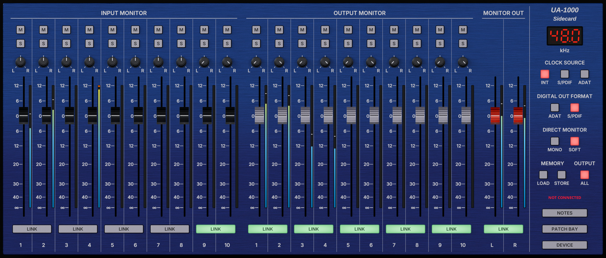

*The meters in this picture show readings set for the picture: no signal was playing.*

The UA-1000 has two monitor mixers inside it, and the desk shows both, as a console would:

| Section | What it mixes |
|---|---|
| **INPUT MONITOR** 1-10 | The device's inputs (1-8 analog, 9-10 digital), as you hear them while you play: the *direct monitor*, with no trip through the computer. |
| **OUTPUT MONITOR** 1-10 | What the computer plays to each of its ten outputs (WAVE OUT 1-10). |
| **MONITOR OUT** L/R | The level of the mix of both, which goes to the phones and the main outputs. |
| The master section (right) | The sample rate, the front panel's switches, the memories, NOTES, PATCH BAY and DEVICE. |

Where the two mixers go is the Owner's Manual's block diagram (p. 52): INPUT MONITOR feeds WAVE OUT MONITOR, which
adds the computer's playback, and that mix is MONITOR OUT. The front panel's OUTPUT volume knob then sets how loud
it leaves the device.

**INPUT MONITOR only works with SOFT CTRL on.** With the front panel's SOFT CTRL switch off (it is the SOFT button
on the desk), the device mixes the inputs itself with its DIRECT MONITOR knob, and ignores this mixer (Owner's
Manual p. 38).

## A channel strip

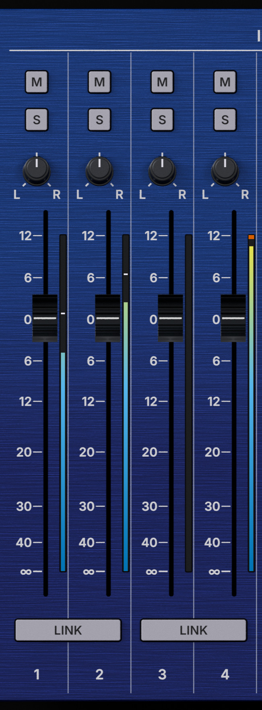

*Input strips 1-4. The meters show readings set for the picture; input 4's clip light is lit to show it.*

From top to bottom:

| Control | What it does |
|---|---|
| **M** (mute) | Silences the channel. Lit red while muted. |
| **S** (solo) | Solos the channel: in its mixer, only the soloed channels are heard. Lit green while on. The device holds one solo per pair: in an unlinked pair, soloing one channel takes the solo from the other (on a linked pair, S solos both). Linking a pair with one soloed solos both; unlinking a soloed pair takes the solo off both. |
| **Pan knob** | Places the channel between L and R. Drag up or right to turn it right; scroll; or use the arrow and Page Up/Down keys when it has the focus. A double click centres it. |
| **Fader** | The channel's level, from −∞ to +12 dB; the scale beside it is in dB. 0 dB is unity. Drag its cap: the cap follows the pointer. A click on the travel does nothing (no jump in level); a double click returns it to 0 dB. |
| **Meter** | The signal arriving at the channel (see [Reading the meters](#reading-the-meters)). |
| **LINK** | Under each pair: makes the two channels a stereo pair (next section). |
| **Number** | The channel. |

## Linking two channels

LINK (lit green) joins two channels into a stereo pair, as the vendor's panel does:

- A **fader** move, **M** or **S** on one moves both.
- The **pan** of the partner mirrors: hard left on one puts the other hard right. (The vendor's own behaviour for
  pan on a linked pair was never captured, so this is this editor's choice, marked *inferred* in
  [`PROTOCOL.md`](PROTOCOL.md).)

## MONITOR OUT

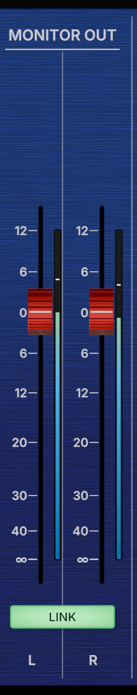

*The meters show readings set for the picture.*

MONITOR OUT has only a fader per side and a LINK: the device has no pan, mute or solo there. Its meters are the
only ones that show **the mix itself**, after every fader, M, S, pan and MONO of both mixers, measured from the
device's own output (see [Reading the meters](#reading-the-meters)).

## The master section

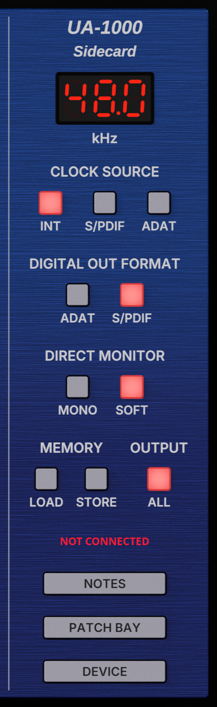

From top to bottom: the sample-rate display, CLOCK SOURCE, DIGITAL OUT FORMAT, DIRECT MONITOR (MONO and SOFT), then
MEMORY (LOAD and STORE) and OUTPUT (ALL) side by side, the connection status, and the NOTES, PATCH BAY and DEVICE
buttons. The blocks follow the device's own front panel: MONO and SOFT CTRL are its DIRECT MONITOR section, ALL the
switch beside its OUTPUT volume knob.

**The connection status**, between MEMORY / OUTPUT and NOTES:

- **CONNECTED** (green): the panel holds the device's control port, and every change reaches the device at once.
- **NOT CONNECTED** (red): no device, or its control port is not reachable (no patched driver), or another program
  holds it. The panel keeps working on its own state; DEVICE > Reconnect tries again, and the state is sent when
  the device connects.

## The sample-rate display and the USER SET

The red display shows the sample rate the device runs at. **The UA-1000 sets its sample rate only when it is
switched on**, from the SAMPLE RATE switch on its front panel; at the USER SET position, from the rate stored in its
USER SET.

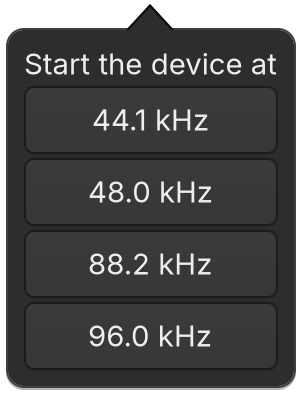

A click on the display opens this menu: the rate chosen is **stored in the USER SET**, the device's power-on
settings. The panel sends the rate and the panel switches; read back from the device, the USER SET also holds the
patch bay and both mixers as they were when it was stored, and with the switch on USER SET the device powers up in
exactly that state: what changed after the store is gone at the next power-on. A notice then says how to use it:

1. Close every program that is using the UA-1000.
2. Turn the SAMPLE RATE switch on the front panel to USER SET.
3. Turn the UA-1000 off, and on again.

The USER SET also keeps the panel switches as they are when it is stored. DEVICE > Store USER SET… does the same
from a dialog:

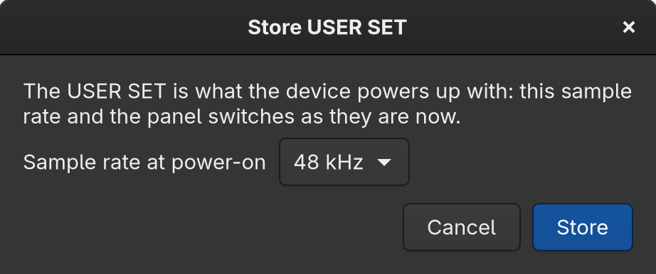

ADAT works only at 44.1 and 48 kHz (Owner's Manual p. 41): a USER SET at 88.2 or 96 kHz with ADAT on is refused.

## CLOCK SOURCE, DIGITAL OUT FORMAT and the panel switches

| Buttons | What they choose |
|---|---|
| **CLOCK SOURCE**: INT, S/PDIF, ADAT | Where the device takes its sample clock from: its own (INT), or the signal **arriving** at its S/PDIF or ADAT input. One is always on. |
| **DIGITAL OUT FORMAT**: ADAT, S/PDIF | The format of its digital **output**. One is always on. |
| **MONO** | The direct monitor in mono: only the **inputs** you hear, not the computer's playback, which stays stereo; and what is recorded stays stereo too (Owner's Manual p. 13). Handy with a single mic or guitar on one input: it reaches both ears. |
| **SOFT** | SOFT CTRL: the direct monitor follows the INPUT MONITOR mixer on this panel. Off, the device uses its DIRECT MONITOR knob. |
| **ALL** | What the front panel's OUTPUT volume knob acts on: lit, every output; dark, the main output only. **Mind your speakers:** with ALL dark, outputs 1-2 played at full level whatever the knob's position (measured, monitors on outputs 1-2). Keep ALL lit unless you know where the main output goes. |

**With nothing connected to S/PDIF or ADAT, keep CLOCK SOURCE on INT.** On S/PDIF or ADAT with no signal arriving,
the device has no clock: audio stops, and it may stop answering the panel. Choosing S/PDIF or ADAT shows this
notice:

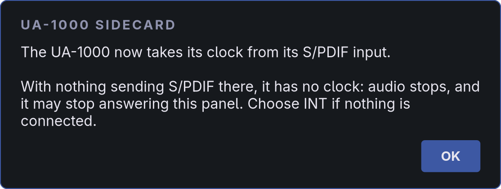

If the device stops answering, the panel says so ("Lost the device") within a second rather than freezing;
choose INT, then DEVICE > Reconnect.

At 88.2 and 96 kHz the ADAT buttons do nothing: the device ignores ADAT at those rates (Owner's Manual p. 41).

## Memories

The device keeps five memories of its settings. **LOAD** and **STORE** open a dialog to choose the slot and which
parts of the settings:

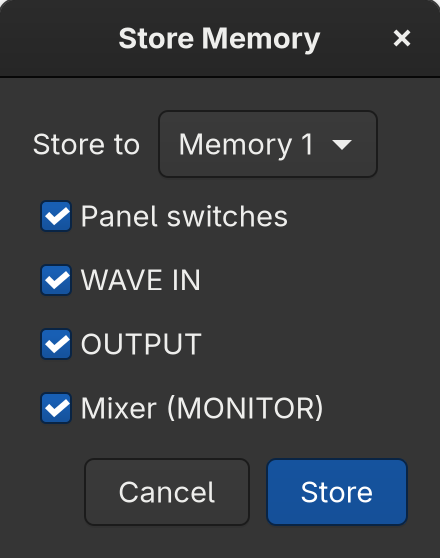 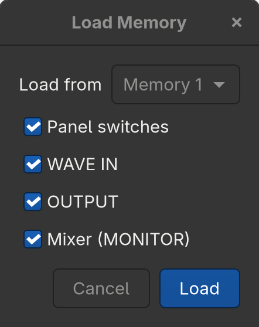

| Part | What it covers |
|---|---|
| Panel switches | CLOCK SOURCE, DIGITAL OUT FORMAT, MONO, SOFT, ALL |
| WAVE IN | What the computer records from (the patch bay's left half) |
| OUTPUT | What each output plays (the patch bay's right half) |
| Mixer (MONITOR) | Both mixers and MONITOR OUT |

The device does not report a load as it happens. So a memory stored by this editor remembers its mixer, and loading
it moves the faders to match. A memory stored by anyone else (the vendor's panel, or before this editor) loads on the
device, but the panel says it cannot show what it holds; DEVICE > Reconnect reads the device again and shows it.

## NOTES

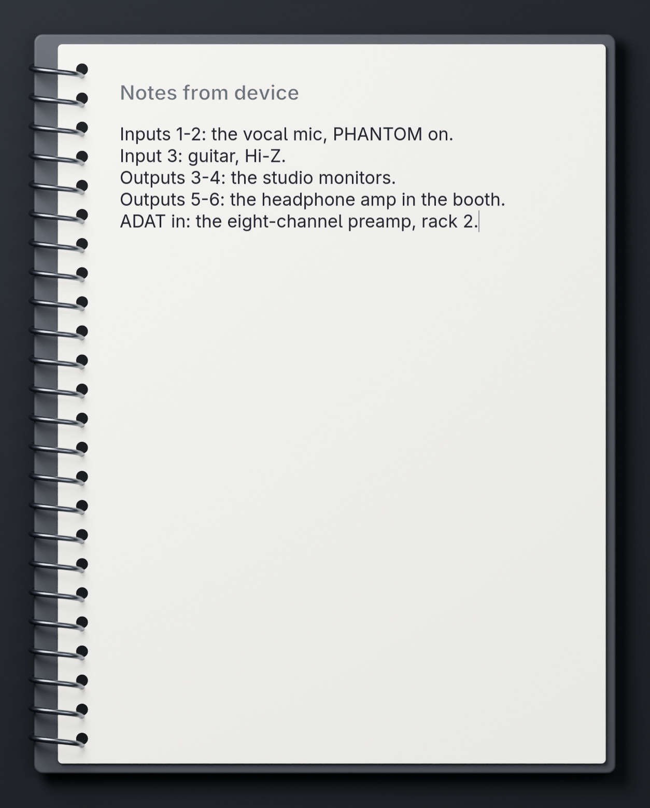

*The text is an example.*

A notepad for what is wired where: what each input, output and digital port of this UA-1000 is connected to,
which is easy to forget and hard to check without unracking it. It is an ordinary text editor: select, copy,
paste, undo and scroll as in any other. It saves itself a moment after each change and when its window closes, in
`~/.local/state/ua1000/notes` (beside the state file).

## PATCH BAY

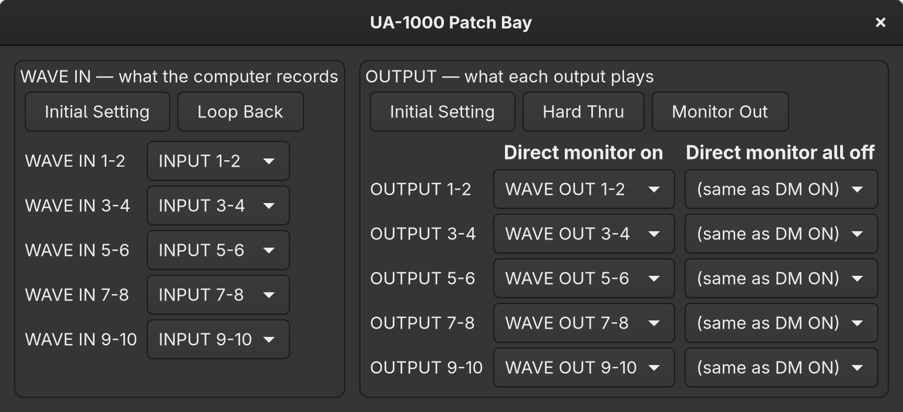

The device's router, in two halves:

- **WAVE IN, what the computer records**: for each of the five stereo pairs the computer records, its source: an
  input pair, a WAVE OUT pair (to record what the computer plays) or MONITOR OUT (to record the mix). A WAVE OUT pair
  is recorded as you hear it in OUTPUT MONITOR: after its fader, mute and pan there (measured on the device).
- **OUTPUT, what each output plays**: for each output pair, its source, in two columns. The device keeps two
  routings and switches between them by itself: **Direct monitor on** while any INPUT MONITOR channel is on, and
  **Direct monitor all off** when all are off (Owner's Manual p. 39). "(same as DM ON)" keeps one routing for both.

The buttons above each half load the device's presets: Initial Setting and Loop Back for WAVE IN; Initial
Setting, Hard Thru and Monitor Out for OUTPUT.

The inputs reach the mix (INPUT MONITOR, and so MONITOR OUT) through the front panel's DIRECT MONITOR volume knob:
turned all the way to the left, nothing of them is heard in the mix, although the panel's input meters, which read
what is recorded, still move (Owner's Manual p. 13; met on the device). At its 0 dB mark the mix gets them at the
level they are recorded at.

## DEVICE: the menu

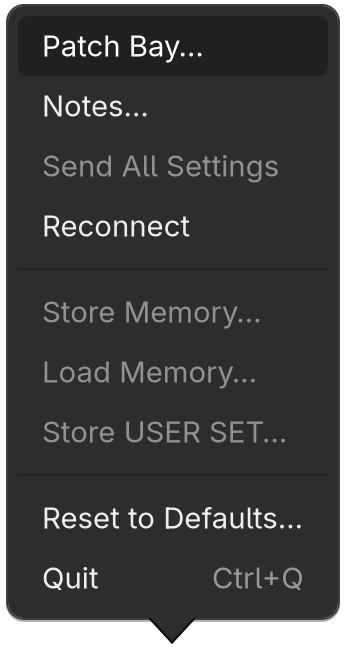

*Without a device, the items that need one are greyed out, as here.*

| Item | What it does |
|---|---|
| Patch Bay… | The patch bay window (also the PATCH BAY button). |
| Notes… | The notepad (also the NOTES button). |
| Send All Settings | Sends the panel's whole state to the device: makes the device match what you see. |
| Reconnect | Looks for the device again (after plugging it in, switching it on, or loading the patched driver). |
| Store Memory…, Load Memory… | The memory dialogs (also STORE and LOAD). |
| Store USER SET… | The power-on settings (also a click on the rate display). |
| Reset to Defaults… | Every channel to 0 dB, on, not soloed; OUTPUT 1-10 and INPUT 9-10 (the digital input) as linked stereo pairs, odd channels left and even right (as the vendor's panel shows its pairs, Owner's Manual p. 37); INPUT 1-8, single sources such as a voice or a guitar, centred and unlinked; MONITOR OUT to 0 dB and linked; the switches to the factory's (STEREO, SOFT CTRL on, ADAT off, the internal clock, the OUTPUT volume knob on MAIN: Owner's Manual p. 44) and the patch bay to its initial settings. The device is updated at once; its memories and USER SET are not touched. |
| Quit (Ctrl+Q) | Closes the panel. Everything is already saved. |

## Notices

The panel speaks through notices like the one above (the external clock). The ones you may meet:

| Notice | Means |
|---|---|
| "The device's settings differed from the ones saved…" | The device was changed while the panel was closed (its front panel, another program, a memory): the panel now shows the device's settings. |
| "The editor does not know this device's settings yet…" | The device did not answer the panel's request for its settings (an older driver, or a busy device), and there is no saved state: the device was left alone. DEVICE > Send All Settings makes it match the panel. |
| "Lost the device: …" | The device stopped answering (unplugged, switched off, or without a clock: it is waited for 1 s at most). DEVICE > Reconnect when it is back. |
| "…the MIDI port is in use by another program" | Another program (`ua1000ctl`, or another panel) holds the control port. |
| "…exposes no control port: it needs the cable 1 fix" | The kernel driver is the unpatched one: see [the kernel patch](KERNEL_PATCH.md). |
| "Memory N was not stored by this editor…" | See [Memories](#memories). |
| "ADAT works only at 44.1 or 48 kHz…" | See [CLOCK SOURCE…](#clock-source-digital-out-format-and-the-panel-switches). |

Return or Escape closes a notice.

## Reading the meters

Each fader has a meter beside it. The UA-1000 sends no levels, so the panel measures the audio itself, as it
travels between the device and the computer. Two kinds, by what the device lets us measure:

- **The strip meters show the signal arriving at that strip, before anything the mixer does to it** (pre-fader).
  No strip is tapped after its fader, so a strip's own post-fader level cannot be measured.
- **MONITOR OUT's meters show the mix itself, after the mixer** (post-fader). The device sends its monitor mix back
  to the computer as the capture pair "MAIN", channels 11-12 (Owner's Manual, block diagram p. 52): what both mixers
  make of every fader, M, S, pan and MONO, measured, not calculated.

| Meter | What it shows |
|---|---|
| INPUT MONITOR 1-10 | The signal on that input, as the device digitises it: after the input's sensitivity knob and PAD switch (inputs 1-8; Owner's Manual p. 12), before this mixer. It needs the patch bay to send that input's pair to the computer (WAVE IN); otherwise its well stays dark. |
| OUTPUT MONITOR 1-10 | What the computer plays to that output, before this mixer. |
| MONITOR OUT L/R | The monitor mix (MAIN), after both mixers: it moves with every fader, M, S, pan and MONO. Taken before the front panel's OUTPUT volume knob (the block diagram shows the tap before it). |

**How to read them:** a strip meter says whether a signal reaches the strip; MONITOR OUT says what your mix sends
to the phones and the main outputs. A strip can show a full meter while MONITOR OUT shows nothing: its fader is
down, it is muted, or another strip is soloed.

**What none of them sees: the front panel's OUTPUT volume knob.** It sends nothing, and the mix is tapped before
it, as a console's master meter is before its control-room level. With MONITOR OUT at a healthy level and silent
phones, look at that knob: the device's own output level LEDs are the only meter after it (Owner's Manual p. 14).
(The DIRECT MONITOR knob acts on the inputs before the mixer, Owner's Manual p. 13, so MONITOR OUT does follow it;
the strip meters do not.)

Why the strips are not post-fader by calculation: the panel could add each fader's gain to the strip's signal,
but it cannot confirm what the device does with SOLO, and a calculated level can show what is not there. Every
meter here shows a level that was measured.

- **Scale:** from −60 dBFS (bottom) to 0 dBFS (top), the full scale of the digital signal. It is not the fader's
  scale beside it, which is the fader's gain.
- **Colour:** blue at low levels, through sky blue, to yellow near full scale (a scale that colour-blind readers
  tell apart, and that reads in grey too).
- **Peak line:** a light line holds the highest recent peak for 1.5 s.
- **Clip light:** a vermilion cap at the top of the meter lights for 2 s when the signal reaches full scale
  (within 0.01 dB). On an input, the signal is clipping: turn that input's sensitivity knob down (or engage its
  PAD) until the light stays off. The device's own input peak indicators light earlier, at −6 dB (Owner's Manual
  p. 12): a red light on the device with a quiet clip light here is a warning, not yet a clip.
- **Fall:** the bar falls at about 12 dB per second, as a peak meter does.

**The meters need a sound server**: PipeWire with `pipewire-jack`, or JACK, running on the UA-1000. Without one
the wells stay dark, and hovering one says why. The panel looks for a server every 2 s: start one, or restart it, and
the meters come back by themselves. With jackd, the panel checks which card it runs on (jackd names it in its ports'
aliases): a jackd on another card gives no meters, rather than that card's inputs shown as the UA-1000's.

## Keyboard and mouse

| Where | Mouse | Keyboard (when it has the focus) |
|---|---|---|
| Fader | Drag the cap; scroll. A click on the travel does nothing | Arrows, Page Up/Down, Home/End |
| Pan knob | Drag up or right to turn right; scroll | Arrows; Page Up/Down (5 steps); Home centres it |
| Fader or pan | **Double click: back to 0 dB / centre** | |
| Any button | Click | Space or Return |
| Everywhere | | Tab moves the focus; Ctrl+Q quits |

An amber frame shows which control has the focus while you use the keyboard; it does not appear with the mouse.

## The window

The whole window is the desk. It opens at most at 85 % of the screen and can be resized to any size, down to a
quarter of the panel: the panel keeps its proportions and scales with it, and every control works the same at any
size.

## Without the desk's images: the plain layout

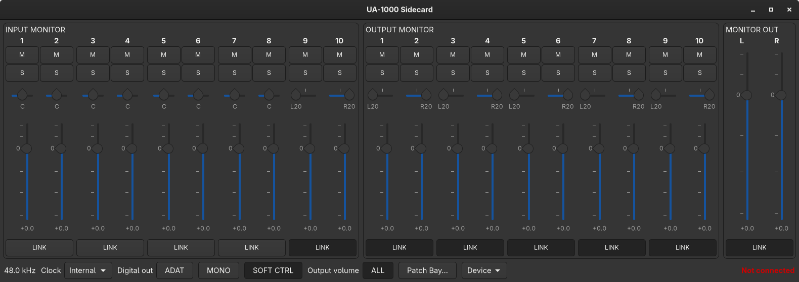

Without the desk's images, the panel uses GTK's own widgets: the same mixers, switches and menu, laid out plainly.
The images are looked for in `$SIDECARD_DESK` if set (empty: the plain layout), else in the installed
`share/sidecard/desk`, where `make install` puts the repository's `data/desk`. To run the panel from the build
directory with its images: `SIDECARD_DESK=data/desk ./ua1000gui`. `SIDECARD_DESK= ua1000gui` shows the plain layout.

## What the panel remembers

The editor keeps the settings in one state file, shared by both programs: `$XDG_STATE_HOME/ua1000/state`, or
`~/.local/state/ua1000/state`. It is plain text, and a line it cannot read is reported with its number.

When the panel connects, it asks the device for its settings, shows them and saves them: the device wins. Two things
the device cannot report come from the file instead: the memories this editor stored, and the solos (the device keeps
only the last solo written, not which pair: the panel gives the device its own solos, which the device has no
switches for). If the device does not answer within a second, the panel sends the saved state, as before it could
ask.

Only one program can hold the device's control port at a time. While the panel is connected, `ua1000ctl` reports
the port busy, exits with an error and changes nothing (`status` and `-n` still work): make the change in the panel,
or close it first. While the panel is open but NOT CONNECTED, a change made with `ua1000ctl` reaches the device and
the state file, and the panel picks it up from there. If the panel had a change of its own waiting to be saved
(it saves 0.3 s after the last one), the file still wins, since it is what the device received: the panel drops its
waiting change and says so.

## The command line: ua1000ctl

Everything the panel does, from a terminal or a script:

```sh
ua1000ctl input 1 gain -6          # INPUT MONITOR channel 1 to -6 dB
ua1000ctl output 3-4 link on       # link OUTPUT MONITOR channels 3 and 4
ua1000ctl output 3 pan L20         # hard left; the linked partner goes hard right
ua1000ctl monitor gain 0           # MONITOR OUT, both sides while linked
ua1000ctl panel mono on
ua1000ctl route wave-in 1-2 monitor-out
ua1000ctl preset output hard-thru
ua1000ctl memory store 2 panel,monitor
ua1000ctl status                   # what the editor knows, without the device
ua1000ctl -n input 1 mute on       # print the message instead of sending it
ua1000ctl ports                    # the MIDI ports, the control port marked
```

The control port is found by its name ("UA-1000 Control"); `-p hw:N,D,S` chooses another. `man ua1000ctl` has
every command.
